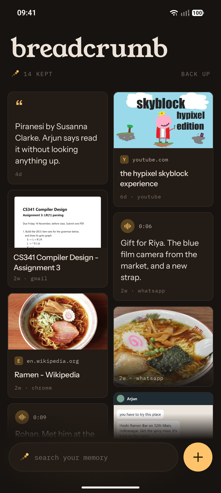
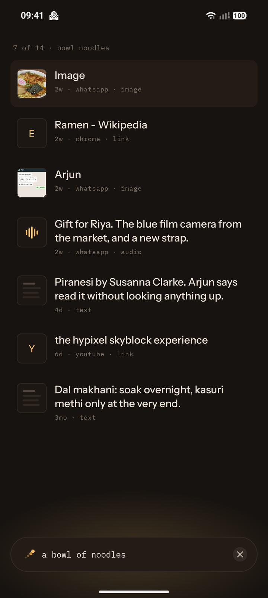
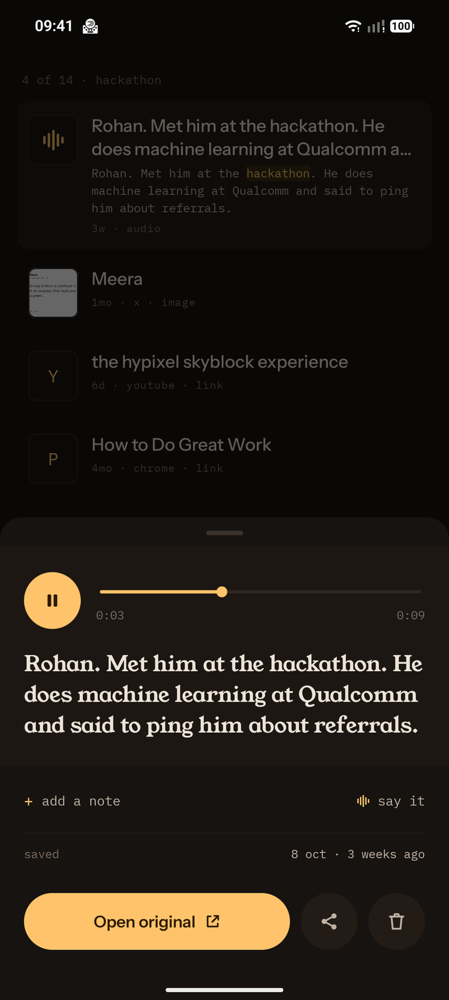
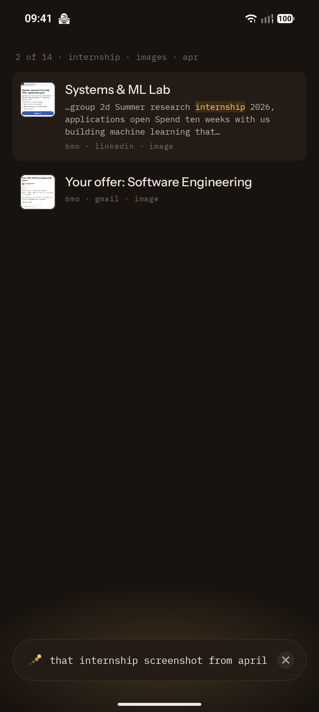
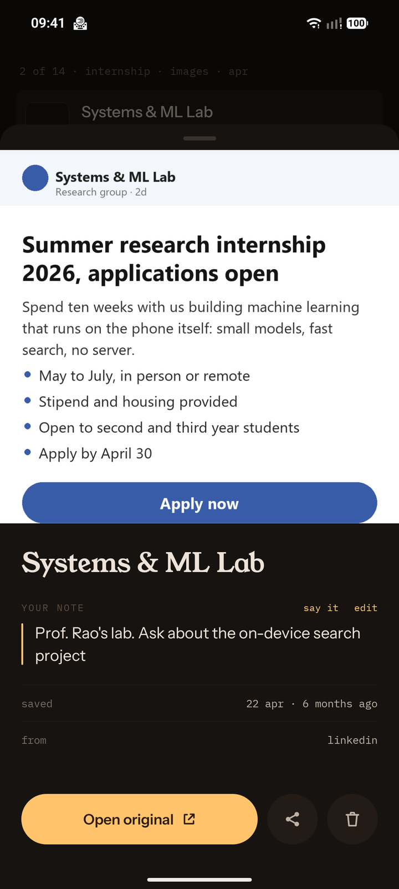
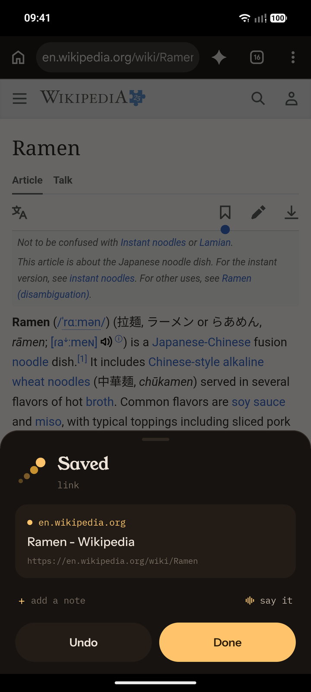
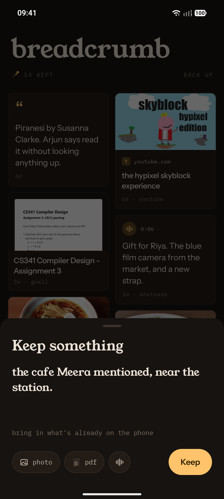
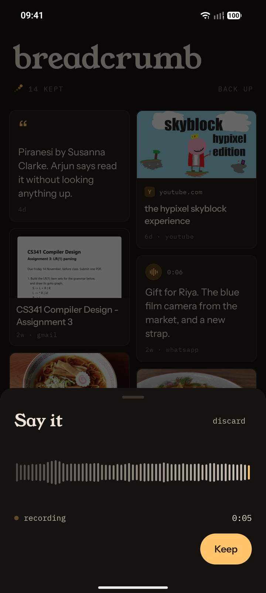
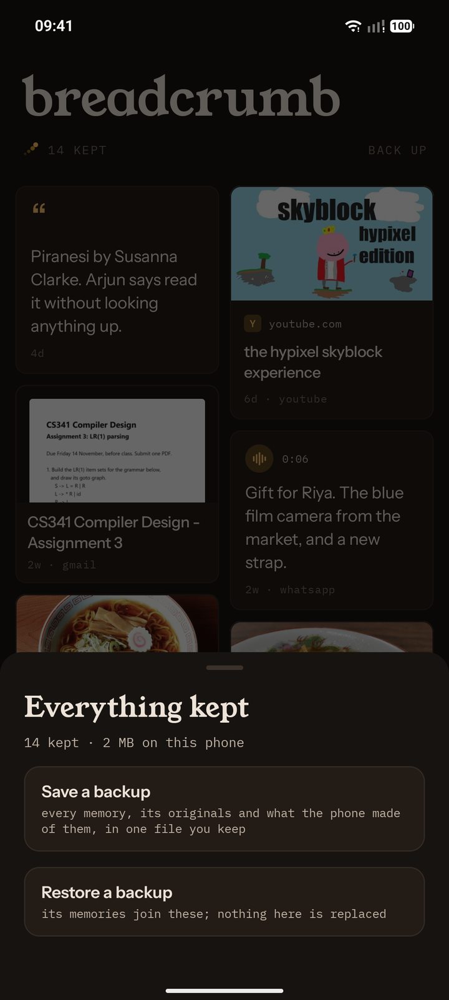
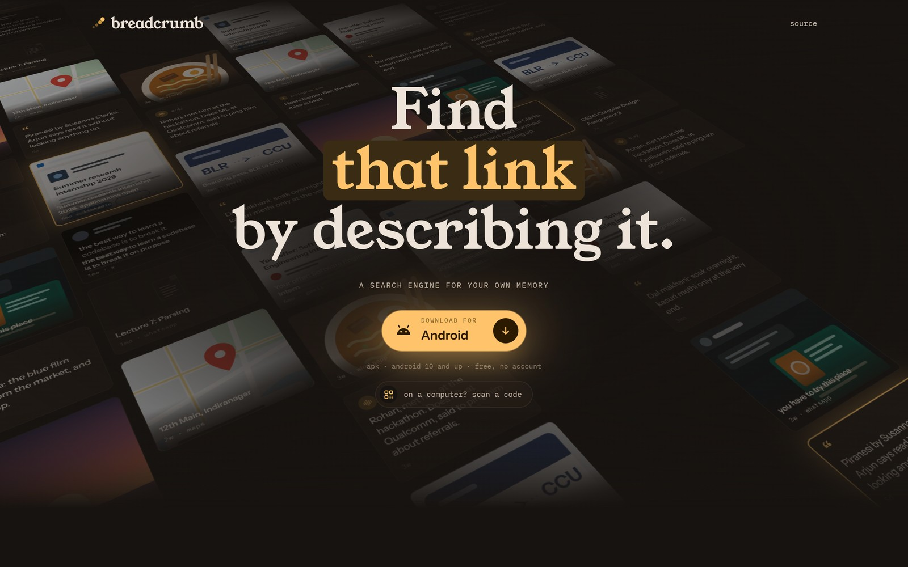

# Breadcrumb

**A search engine for your own memory.**

Save anything in one tap. Find it later by describing it the way you actually remember it.

🏆 **1st place at [Hackinverse 1.0](https://hackinverse-s1.devfolio.co/overview).** Project page on
[Devfolio](https://devfolio.co/projects/breadcrumb-54b8).

**Get it at [breadcrumb.suparno.me](https://breadcrumb.suparno.me)**, or
[download the latest APK](https://github.com/letsbecool9792/breadcrumb-hackinverse/releases/latest/download/breadcrumb.apk)
directly, for Android 10 and up (64-bit phones). Every version is on
[GitHub Releases](https://github.com/letsbecool9792/breadcrumb-hackinverse/releases).
It isn't on the Play Store yet, so Android asks you to allow installing from your browser.

<table>
  <tr>
    <td align="center" width="33%"><br><sub>everything you've kept, newest first</sub></td>
    <td align="center" width="33%"><br><sub>&ldquo;a bowl of noodles&rdquo; finds a photo with no words in it</sub></td>
    <td align="center" width="33%"><br><sub>voice notes, heard on the phone, found by what was said</sub></td>
  </tr>
</table>

---

## The problem

We save information everywhere and find it nowhere.

Screenshots, links, PDFs, photos, recommendations: they end up scattered across a dozen apps.
Later you remember *what* you saved and roughly the context around it, but not *where* you put
it. So you search your gallery, then your bookmarks, then WhatsApp, and eventually give up.

Research on re-finding information bears this out: people fall back on bookmarking (~80%),
searching again from scratch (~54%), re-typing URLs (~51%), even emailing things to themselves
(~36%), and no single method covers everything they need. Existing tools each solve a slice.
None unify personal information retrieval.

## The idea

Breadcrumb is two flows and nothing else:

> **Save → Forget about it → Search → Find**

**Saving is frictionless.** Share sheet, a Quick Settings tile, or your voice. No folders, no
tags, no titles, no organizing. You are never asked to do work at save time.

**Retrieval is the product.** One search bar. You type what you remember:

- *"that internship screenshot from April"*
- *"the restaurant somebody recommended"*
- *"that guy from the hackathon who worked at Qualcomm"*
- *"the PDF my professor sent"*

It finds the thing even when your words don't match the original content, because it
understands meaning and context, not just keywords.

## Reference memory, not action memory

- **Action memory**: *"I need to **do** something later."* Pay a bill, submit an assignment.
  Calendars, reminders and task managers already do this well. Breadcrumb doesn't compete here.
- **Reference memory**: *"I need to **remember** something later."* A restaurant rec, a useful
  article, an internship posting, a person you met at an event. Nothing needs to happen with
  these. You just want to find them again.

Breadcrumb is only the second one. It is **not** a notes app, a bookmark manager, a task manager,
or a second brain. It should feel like a personal search engine, not a digital notebook.

## How it works

**Saving**

```
share / tile / "+"  →  saved on the phone, instantly  →  background work, on the phone
                                                                ↓
                                    OCR of pictures, PDFs' text, links' pages and previews
                                                                ↓
                                    EmbeddingGemma 2 turns it into a vector (a picture with
                                    no words is embedded as a picture)
```

Saving never waits on the network, and nothing you save leaves the phone. Search works in
airplane mode.

**Retrieving**

```
"that internship screenshot from April"
              ↓
    the phrase is embedded on the phone, and scored against every memory
              ↓
    fused with the phone's own word search, by rank
              ↓
    narrowed by date, type and app, read from the phrase on the phone
              ↓
    ranked memories → tap to open the original
```

Meaning and words together, because the queries people actually type are full of proper nouns:
"Qualcomm" needs words while the rest of the sentence needs meaning.

**Nothing leaves the phone.** Not what you save, and not what you type: "from April",
"screenshot" or "on WhatsApp" are read into filters on the phone. There is no server and no
account. The phone goes online only to read the page of a link you saved, and once to download
the embedding model.

## More of the app

<table>
  <tr>
    <td align="center" width="33%"><br><sub>&ldquo;screenshot&rdquo; and &ldquo;from april&rdquo; become filters</sub></td>
    <td align="center" width="33%"><br><sub>the original, your note, where it came from</sub></td>
    <td align="center" width="33%"><br><sub>share from any app: saved in one tap</sub></td>
  </tr>
  <tr>
    <td align="center" width="33%"><br><sub>or keep something from inside the app</sub></td>
    <td align="center" width="33%"><br><sub>or just say it</sub></td>
    <td align="center" width="33%"><br><sub>everything out to one file, and back in on a new phone</sub></td>
  </tr>
</table>

<sub>The memories are made up for the screenshots; the ramen photo is by
<a href="https://commons.wikimedia.org/wiki/File:Ramen_Tamari_001.jpg">Ocdp</a>, CC0. More in
<a href="screenshots/"><code>screenshots/</code></a>, the website's too.</sub>

## The website

[breadcrumb.suparno.me](https://breadcrumb.suparno.me) shows the app instead of explaining it, and
downloads the latest release.

<a href="https://breadcrumb.suparno.me"></a>

## Stack

| | |
|---|---|
| **Mobile** | Native Android: Kotlin, Jetpack Compose, Room (with full-text search), WorkManager |
| **On-device AI** | EmbeddingGemma 2 through LiteRT-LM (text and pictures, pictures on the GPU), ML Kit Text Recognition, the phone's own speech recognizer for voice notes |
| **Website** | Vite + React + Tailwind, on Vercel |
| **Backend (retired)** | Node + Express + TypeScript, MongoDB Atlas, Gemini. Kept in `server/`; the app no longer uses it |

Native Android rather than a cross-platform framework: every capture surface is an Android
platform surface, and every save is a cold start, so a native capture path is the difference
between saving feeling free and saving feeling like a wait.

## Layout

```
android/      Android app (build it with ./gradlew from this folder)
web/          the website, breadcrumb.suparno.me
server/       the Express API the app used until it went mobile only; kept, unused
screenshots/  the app's and the website's
docs/         the screens' design, and one brief per workstream
tools/        generate_icons.py, which draws the launcher and splash icons
```

## Team

Built by [Suparno](https://suparno.me), [Ayushi](https://github.com/aeryxii), [Dhrubaparna](https://github.com/DhrubaIsha2006) and [Aritra](https://github.com/AM2004legend). Who builds what:
[`CLAUDE.md`](CLAUDE.md), "Team and workstreams".

## Status

Won 1st place at Hackinverse 1.0. Saving from anywhere, reading on the phone, search by meaning
and words, voice notes and backups are all in, and v1.1 is out;
[`CLAUDE.md`](CLAUDE.md) tracks what's next.

## Why "Breadcrumb"

From leaving breadcrumbs while walking through a forest. You don't know when you'll want to
return somewhere, so you leave a trail as you go. You drop small pieces of information as you
move through your digital life, then follow the trail back when you need something.
